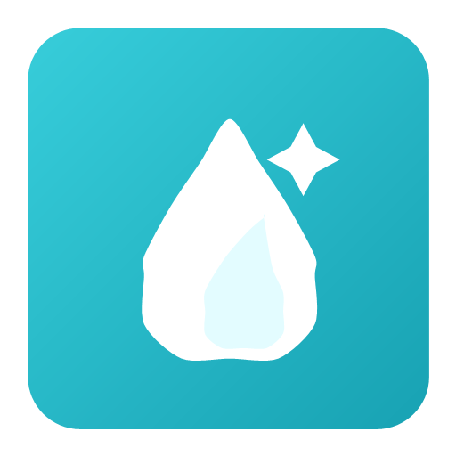

<p align="center">
  
</p>

<h1 align="center">AquaBlesk</h1>

<p align="center">
  Cleaning service website with admin panel, editable content, requests, gallery, reviews and local backend.
</p>


<p align="center">
  <a href="https://bladislabkhan.github.io/cleaning-landing-page/">Live Demo</a>
  &middot;
  <a href="https://bladislabkhan.github.io/cleaning-landing-page/admin/">Admin Panel</a>
  &middot;
  <a href="../../releases/latest">Latest Release</a>
</p>

<p align="center">
  
  
  
  
  
</p>

## About

AquaBlesk is a ready cleaning service website template with a public page, admin panel, editable content, gallery, reviews, request form and local PowerShell backend.


## Local Setup

Run local server:

```powershell
powershell -ExecutionPolicy Bypass -File .\backend\server.ps1 -Port 8080
```

Default admin login and password:

```txt
admin
```

## License

This project is licensed under the [MIT License](./LICENSE).
